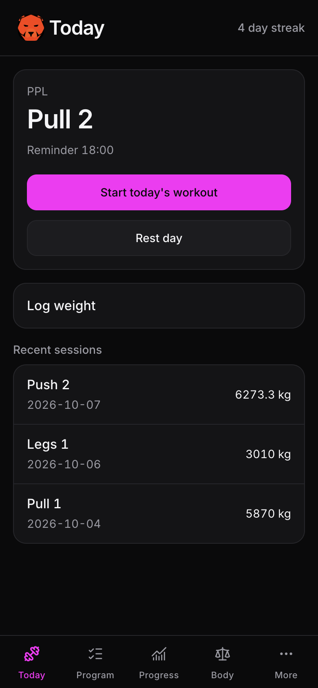
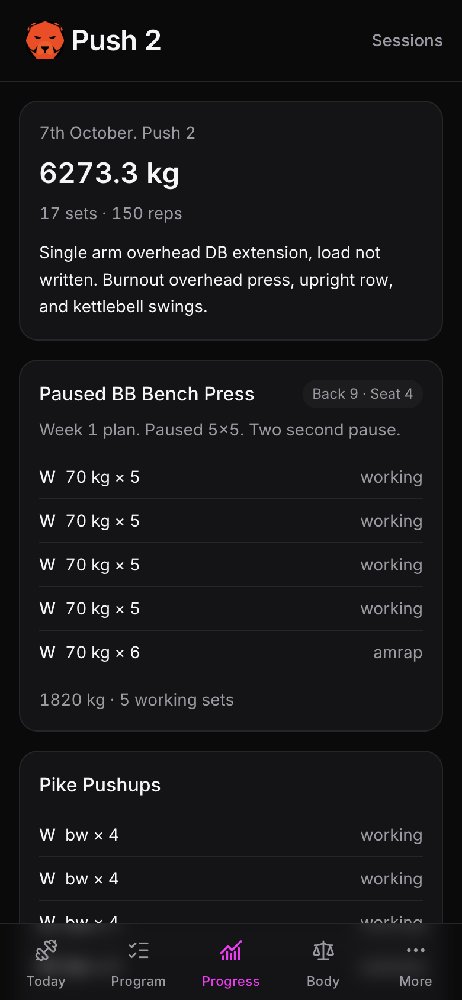
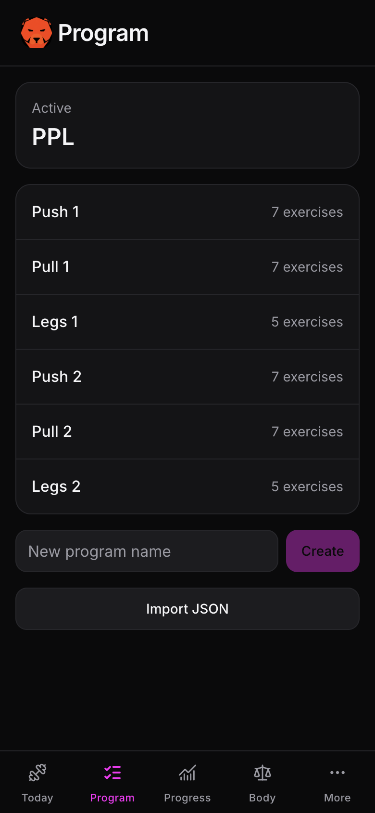
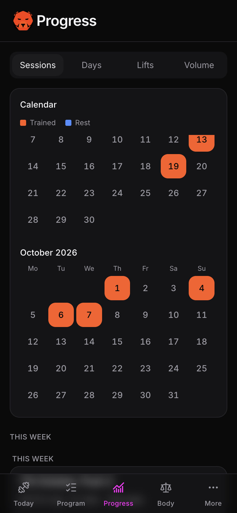
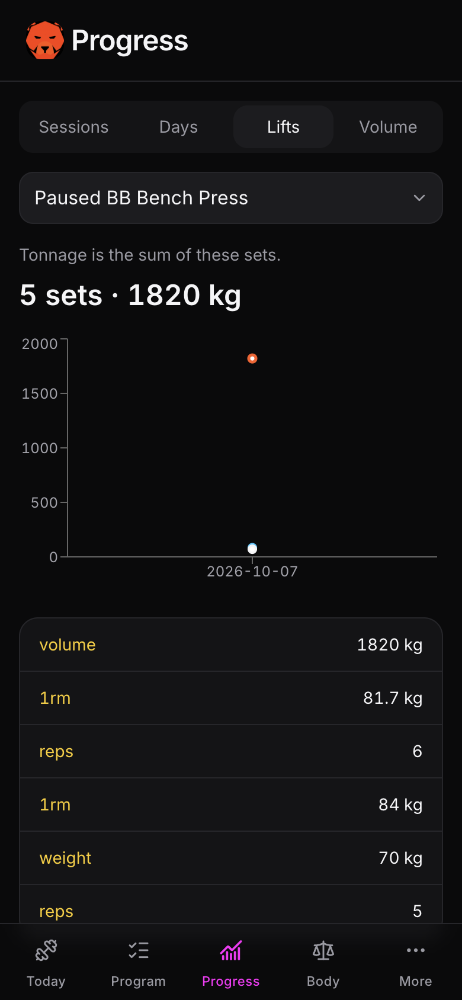
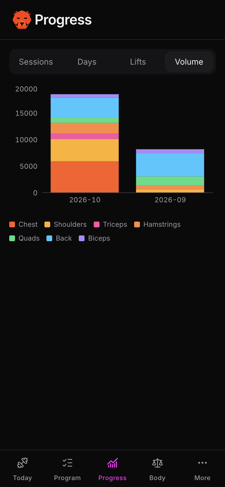

# BigBearLifts

A mobile-first strength log you host yourself. It runs offline in the browser, keeps a program, and syncs to your own Postgres when the network is back.

One account. One password. No accounts service, no third-party analytics.

## Screenshots

Shots from a real phone-width session. The catalog, program, and history live on your machine, not in this repository. These images are the exception: they show one person’s actual training.

| Today | Session |
| --- | --- |
|  |  |

| Program | Calendar |
| --- | --- |
|  |  |

| A lift | Volume |
| --- | --- |
|  |  |

## What it does

- Today shows the next program day, a streak, and recent sessions.
- Logging is set by set: reps, then weight. Warmups, working sets, AMRAP, drops, and partials stay in the same set.
- Each exercise has its own rest timer. The default is 3:00.
- The program is a rotation of days. Opening a day starts the same logger as Today.
- Progress is sessions, a month calendar, per-lift history, and monthly volume by muscle.
- Body weight, photos, and a JSON export stay on the server you run.
- A service worker can remind you at 17:00, and at 21:00 if the day was neither trained nor marked rest. That needs notification permission and a browser that can show scheduled notifications.

## Run it locally

Requirements: Node 20+, Docker, and a terminal.

```bash
cp .env.example .env
npm install
docker compose -f docker-compose.dev.yml up -d
npx prisma migrate dev
npm run db:seed
npm run dev
```

Open [http://localhost:3000](http://localhost:3000).

Fill `.env` before you seed:

1. Set `POSTGRES_PASSWORD` and put the same password in `DATABASE_URL`. The example value `change-me` is a placeholder.
2. Generate a session secret: `openssl rand -base64 32`. Put it in both `NEXTAUTH_SECRET` and `AUTH_SECRET`.
3. Hash the login password and store only the hash:

```bash
npm run hash-password -- "your-password"
```

Paste the hash into `APP_PASSWORD_HASH`. Leave the `$` characters as they are. Only `npm run db:seed` reads that variable. The Next.js server does not, because Next expands `$` in `.env` and would corrupt a bcrypt hash.

4. Set `APP_USERNAME`, `HEIGHT_CM`, and `BODYWEIGHT_KG` for your own account. Those values are server-only.

### Your catalog

Copy the example and replace it with your exercises and days:

```bash
cp data/personal-seed.example.json data/personal-seed.json
```

Point `SEED_FILE` at that path, then run `npm run db:seed` again. `data/personal-seed.json` is gitignored.

## What this repo does not contain

These stay on your machine and are listed in `.gitignore`:

- `.env` (database password, password hash, height, body weight)
- `data/personal-seed.json` (your exercise list and program)
- `scripts/import-notes.ts` if you keep a private importer
- `uploads/` (physique videos)

Do not commit them. `.env.example` has the keys and empty personal fields.

## Stack

Next.js 14, React 18, TypeScript, Tailwind, Prisma, PostgreSQL, Dexie, Auth.js. Workouts are written to IndexedDB first and synced to Postgres.

Production hosting (the EC2 guide) is not in this repository yet.
